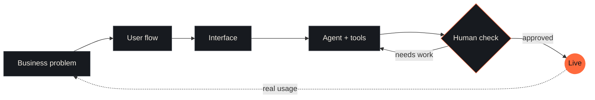

<p align="center">
  
</p>

<p align="center">
  <a href="https://www.linkedin.com/in/abuhuraira2129"></a>
  <a href="mailto:abuhuraira2129@gmail.com"></a>
  
</p>

### Hi, I'm Huraira.

I build **WhatsApp AI agents for sales and support, and the CRMs behind them**. I take each one from a messy business problem to a product people use every day: the user flow, the interface, the agent and its guardrails, and the full-stack app around it.

I started as a UI/UX designer, so I still design every screen myself. Then I build it with AI coding agents (Claude Code, Cursor) and MCP, and I keep a human in the loop for anything that touches a customer.

---

### How I build

```ts
// huraira.config.ts
export const huraira = {
  role: "AI Product Engineer",
  based: "Islamabad, Pakistan · remote-first · UTC+5",

  builds: [
    "WhatsApp AI agents for sales and support",
    "the CRMs and dashboards behind them",
    "voice agents that join live calls",
    "internal tools that replace spreadsheets and chasing",
  ],

  rules: [
    "Nothing customer-facing ships without a human approving it.",
    "If it can be a rule in code, it should not be a paragraph of prompt.",
    "Check what the agent actually did, not what it reported.",
    "If a screen confuses a real user, the feature is not done.",
  ],

  openTo: ["Product Engineer", "AI Engineer", "Forward-Deployed Engineer"],
} as const;
```

---

### The loop every project runs through



---

### Recent builds

| Build | What it does | Stack |
|---|---|---|
| **WhatsApp sales agent + CRM** | Answers buyers only from a client-approved brief, captures and qualifies leads, and hands off to a person with the full conversation. Built for a software company in Saudi Arabia. | Next.js · PostgreSQL · WhatsApp Business API · LLMs |
| **Live-call voice agent** | Joins Google Meet calls and briefs a founder by voice. Works in stages (evidence, opinion, suggestion, action) so it reports before it acts. | FastAPI · Recall.ai · DeepSeek · edge-tts |
| **Daily briefing pipeline** | Pulls a company knowledge base into a database every day and turns it into Claude-written briefings. | TypeScript · GitHub Actions · Supabase · Claude |
| **Role-based ERP** | One app, four dashboards (CEO, Operations, QMP, Mentor), dual approval before work goes live, and payment requests that move from approved to paid. *In build.* | Next.js · RBAC · notifications |
| **Agent loops for engineering** | A triage loop and a coding loop that use GitHub Issues as the control plane. | GitHub Actions · Claude |

Most of this is client work, so the code is private. Happy to walk through any of it on a call.

<!--
  OPEN SOURCE: add 2 to 3 public repos here once they are cleaned up and pinned, for example:
  | [Taskify](https://github.com/AbuHuraira2129/REPO-NAME) | AI project platform with Kanban, Gantt and real-time updates | MERN · Socket.io · Gemini |
-->

---

### Stack

**AI and agents**
<br/>


**Product and frontend**
<br/>


**Backend and data**
<br/>


**Ship and run**
<br/>


---

### Background

- **5+ years** of client delivery for founders and small businesses in the US, the Gulf and Pakistan, from scoping and pricing to launch and support.
- **BS Software Engineering**, NUML Islamabad. MERN Stack Fellowship, Bytewise.
- Design work: [Dribbble](https://dribbble.com/abuhuraira2129) · [Behance](https://www.behance.net/abuhuraira2129)

<p align="center"><sub>Got a business problem that an AI agent should solve, safely? <a href="mailto:abuhuraira2129@gmail.com">Write to me</a>.</sub></p>
